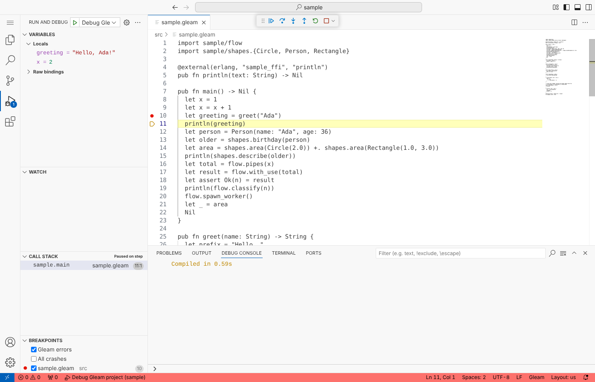

# gleam-dap

A debugger for Gleam programs on the Erlang VM. It speaks the
[Debug Adapter Protocol](https://microsoft.github.io/debug-adapter-protocol/),
so it works in VS Code and in IntelliJ through
[LSP4IJ](https://github.com/redhat-developer/lsp4ij).



- Breakpoints on `.gleam` lines, including conditions, hit counts and
  logpoints, and function breakpoints such as `app/user.greet/1`.
- Continue, step over, step into, step out and pause, with step over
  corrected for Gleam's tail calls.
- Every stopped BEAM process is a thread, with a stack trace in `.gleam`
  lines and Gleam function names.
- Variables with their Gleam names (`x`, not `X@1`) and Gleam-looking values:
  `Person(name: "Ada", age: 36)`, `Some(1)`, `dict.from_list([...])`.
- Stops on `panic`, `todo` and failed `let assert` with the error message.
- A debug console that evaluates expressions over the current variables.
- Attach to a running node, and `debug.break()` to stop from code.

This is a personal tool, written in Gleam on top of Erlang's `int`
interpreter. [PLAN.md](PLAN.md) explains the design and
[open-questions/](open-questions/) lists the decisions taken while building
it.

## Requirements

- **Gleam 1.19 or newer.** Since 1.19 the compiler records Gleam line numbers
  in the compiled code, which is what lets `int` work in `.gleam` lines.
- **Erlang/OTP 27 or newer** with the `debugger` application. Most
  installations include it; on Debian and Ubuntu it is the `erlang-debugger`
  package (or use `erlang` or `erlang-nox`, which pull it in).
- Linux or macOS. Windows isn't supported yet (the launcher is a shell
  script and the adapter hasn't been tried there).

## Building the adapter

```sh
git clone https://github.com/LLaeufer/gleam-dap
cd gleam-dap
escript scripts/package.escript
```

This leaves a self-contained adapter in `dist/gleam-dap`. The editor runs
`dist/gleam-dap/bin/gleam-dap`, which starts `erl` and talks DAP on stdin and
stdout. The adapter's own copies of `gleam_stdlib` and `gleam_erlang` are
renamed inside the package, so they never clash with the versions your
program uses.

## VS Code

Build the extension, which bundles the adapter:

```sh
sh editors/vscode/build.sh            # needs Node.js for npx
code --install-extension editors/vscode/gleam-dap.vsix
```

Then open a Gleam project, set a breakpoint and press F5. Without a
`launch.json` the extension debugs the project's `main` function. To
configure it, run "Debug: Add Configuration..." and pick one of the Gleam
snippets:

```jsonc
{
  "version": "0.2.0",
  "configurations": [
    {
      "type": "gleam",
      "request": "launch",
      "name": "Debug Gleam project",
      "projectDir": "${workspaceFolder}"
    }
  ]
}
```

Settings:

- `gleamDap.adapterPath`: use another adapter, such as a
  `dist/gleam-dap/bin/gleam-dap` you built yourself, instead of the bundled
  one.
- `gleamDap.logFile`: write the adapter's internal log to this file.

The extension only adds debugging. For syntax highlighting and the language
server, install the official Gleam extension as well.

## IntelliJ (LSP4IJ)

1. Install the LSP4IJ plugin (and the Gleam plugin for highlighting, if you
   want it).
2. Open **Run > Edit Configurations...**, add a **Debug Adapter Protocol**
   configuration, and on its **Server** tab choose
   **Import from custom template...**. Pick the
   [`editors/intellij/gleam-dap`](editors/intellij/gleam-dap) folder of this
   repository.
3. Change the command to the full path of your `dist/gleam-dap/bin/gleam-dap`.
4. On the **Configuration** tab, keep the debug mode on **Launch** and pick
   one of the configurations: debug the project, debug its tests, or attach
   to a node. The JSON is the same as for VS Code; `${workspaceFolder}` is
   the configuration's working directory.

Keep the mode on **Launch** even for attaching: LSP4IJ's Attach mode expects
an adapter that is already listening on a socket, while gleam-dap is started
by the editor. A launch configuration with a `node` attaches to that node.

The template follows the format LSP4IJ's template loader reads, but hasn't
been tried in a running IntelliJ yet.

## A quick tour

The repository's test fixture is a small project that shows most features:

```sh
code fixtures/sample      # or open it in IntelliJ
```

1. Open `src/sample.gleam`, set a breakpoint on `let greeting = greet("Ada")`
   and start debugging. The program stops there, and **Locals** shows `x = 2`.
   The earlier `x = 1` it shadows is under **Raw bindings**, with the Erlang
   names the compiler gave them.
2. Step over (F10) to the next line and `greeting` appears. Step into
   `shapes.birthday(person)` a few lines down and step out again.
3. In the debug console, try `x + 1`, `greeting <> "?"` or `flow.double(x)`.
   Once `person` exists, `person.name` reads a field by its label.
4. Right-click a breakpoint to add a condition such as `n > 2`, a hit count
   such as `3` or a log message such as `n is {n}`.
5. Set the entry function to a crashing one (`"function": "crash_main"`) to
   see the debugger stop on a failed `let assert`, with the message and the
   value that didn't match.

## Launch options

| Option | Default | What it does |
| --- | --- | --- |
| `projectDir` | the workspace | The Gleam project to debug, the folder with `gleam.toml`. |
| `module` | the project's main module | Gleam module with the entry function, such as `app/cli`. |
| `function` | `main` | Entry function, called with no arguments. |
| `target` | `dev` | `test` runs every `*_test` module of the project with EUnit instead, the way gleeunit does. With `module` set, it calls that module's `function` instead. |
| `env` | `{}` | Environment variables set before the program starts. |
| `stopOnEntry` | `false` | Stop at the first line of the entry function. |
| `interpretDependencies` | `false` | Also debug all dependencies. Interpreted code is much slower, so this is off by default. |
| `interpretModules` | `[]` | Extra modules to debug, as globs over Gleam module names: `gleam/list`, `my_dep/*` (one level), `my_dep/**` (any depth). |
| `excludeModules` | `[]` | Modules never to debug, as globs. Wins over the options above. |
| `stackTraceMode` | `"all"` | `"all"` keeps tail calls on the stack, which shows how Gleam code got somewhere but uses memory in long loops. `"no_tail"` drops them. `"false"` keeps no stack. |
| `noDebug` | `false` | Run without interpreting anything (VS Code's "Run Without Debugging"). |
| `build` | `true` | Run `gleam build` first. |
| `gleamPath` | `gleam` | The `gleam` executable. |
| `node` | | Attach to this node instead of starting the program (see below). |
| `cookie` | `~/.erlang.cookie` | The node's cookie, for attaching. |

Only the modules the debugger interprets can have breakpoints. The project's
own modules always are; a breakpoint in a dependency that isn't interpreted
says so and names the option to change.

## Attaching to a running node

Start your program as a distributed node, for example:

```sh
erl -sname app -setcookie secret -pa build/dev/erlang/*/ebin -eval 'app:main()'
```

and attach with:

```json
{
  "type": "gleam",
  "request": "attach",
  "name": "Attach to Gleam node",
  "projectDir": "${workspaceFolder}",
  "node": "app@yourhost",
  "cookie": "secret",
  "build": false
}
```

The node needs the `debugger` application installed, as the adapter loads
the interpreted modules on it. `build: false` keeps the adapter from
rebuilding the project under the running node; the adapter still reads the
BEAM files in `projectDir` to find the modules. Disconnecting leaves the node running and
puts its modules back to normal; "Terminate" stops it.

## Stopping from code with `debug.break()`

The [`gleam_dap_debug`](packages/gleam_dap_debug) package has a
`debug.break()` function that stops the debugger at the next line, like a
breakpoint you can commit or put behind a condition. Outside the debugger it
does nothing. It isn't on Hex; add it as a path dependency:

```toml
[dependencies]
gleam_dap_debug = { path = "../gleam-dap/packages/gleam_dap_debug" }
```

```gleam
import gleam_dap/debug

pub fn main() {
  let config = load_config()
  debug.break()
  run(config)
}
```

## The debug console, conditions and logpoints

Expressions are Erlang expressions with a Gleam layer on top, which covers
what you usually type:

- Variables by their Gleam names: `x`, `greeting`.
- Field access by label or position: `person.name`, `pair.0`, chained as
  `order.customer.name`.
- Gleam calls: `string.length(name)`, `list.length(items)` (module names
  are resolved to the loaded Gleam module), and Erlang calls such as
  `erlang:length(items)`.
- `True`, `False`, `Nil`, string literals as Gleam strings, `<>`, `==`, `!=`,
  `&&`, `||` and the arithmetic operators.

Anything else is evaluated as Erlang, so Gleam-only syntax such as pipes,
`case` or anonymous `fn` doesn't work. Results are shown as Gleam values.

Breakpoint conditions use the same syntax and must evaluate to `True`. Hit
counts accept `3` (from the third hit on), `>= 3`, `== 3`, `> 3`, `< 3`,
`<= 3` and `% 3` (every third hit). Logpoints print their message instead of
stopping, with `{expression}` replaced by its value.

Function breakpoints take `module.function`, `module.function/arity` or just
`function` (searched in the project's modules), such as
`app/user.greet/1`.

Exception breakpoints: **Gleam errors** (on by default) stops when a process
crashes on `panic`, `todo`, `let assert` or another Gleam error. **All
crashes** also stops on Erlang errors such as `badarg`.

## Known limitations

- Interpreted code runs much slower than compiled code. Only the project's
  own modules are interpreted by default.
- A breakpoint inside a function that you step over doesn't stop: Erlang's
  interpreter doesn't check breakpoints during a step over or step out.
  Continue (F5) to reach it instead.
- Step out lands on the caller's next statement, not on the call that
  returned, because the interpreter only stops at statements.
- With `stackTraceMode: "all"`, long-running loops keep every tail call on
  the stack and use more and more memory. Use `"no_tail"` for those.
- Values show at most 100 items, also when expanded; reach the rest from the
  debug console.
- Entry functions are called without arguments; there is no `args` option.
- Gleam-only expression syntax (pipes, `case`, `fn`) doesn't work in the
  debug console.
- The JavaScript target and Gleam versions before 1.19 aren't supported.
- Windows isn't supported.
- VS Code is tested through code-server; IntelliJ hasn't been tried yet.

## Development

```sh
gleam test                                   # unit, golden and end-to-end tests
gleam format --check src test packages       # the fixtures are left unformatted on purpose
escript scripts/package.escript              # build dist/gleam-dap
GLEAM_DAP_COMMAND="$PWD/dist/gleam-dap/bin/gleam-dap" gleam test   # end-to-end tests against the package
```

- The end-to-end tests in `test/integration_test.gleam` start the adapter,
  drive it with a scripted DAP client against `fixtures/sample` and
  `fixtures/with_deps`, and check the responses and events. Their breakpoints
  use the fixtures' line numbers, so don't reformat the fixtures.
- `test/golden/sample.txt` records the breakable lines of every fixture
  module. When a compiler change moves them, the golden test fails;
  regenerate it with `GLEAM_DAP_UPDATE_GOLDEN=1 gleam test` and check the
  diff.
- Set `GLEAM_DAP_LOG=/path/to/file` to log the adapter's internals.
- `scripts/spike.escript` is the step 1 feasibility spike: it builds the
  fixture, interprets it, and prints bindings and the backtrace at each step.
- `scripts/offline-deps.sh` fetches the dependencies from GitHub into
  `build/packages`, for sandboxes that can't reach Hex.
- CI (`.github/workflows/ci.yml`) runs the tests on OTP 27 and 28, again
  against the packaged adapter, and builds the VS Code extension.

### How it works

The adapter runs in the same VM as the program. It interprets the project's
modules with Erlang's `int`, which, thanks to Gleam 1.19's line numbers,
breaks and steps in `.gleam` lines directly. On top of that it maps files to
modules, corrects step over for tail calls, demangles variable names, renders
values using the record definitions Gleam generates, and reports Gleam
errors. The program's output is captured and sent to the editor. See
[PLAN.md](PLAN.md), [docs/line-mapping.md](docs/line-mapping.md) and
[docs/elixirls-features.md](docs/elixirls-features.md) for the details.

| Path | Contents |
| --- | --- |
| `src/gleam_dap/session.gleam` | Request handling and session state. |
| `src/gleam_dap/dap/` | DAP framing and messages. |
| `src/gleam_dap/project.gleam` | The module and line index built from the BEAM files. |
| `src/gleam_dap/stepping.gleam` | Step over, corrected for tail calls and `use`. |
| `src/gleam_dap/inspect.gleam` | Stack traces, scopes, variables, evaluate, exceptions. |
| `src/gleam_dap/names.gleam`, `value.gleam` | Gleam names and values. |
| `src/gleam_dap/launch.gleam` | Launch options, version checks, building, interpreting. |
| `src/*.erl` | FFI to `int`, I/O, evaluation and the BEAM. |
| `packages/gleam_dap_debug/` | The `debug.break()` package. |
| `editors/` | The VS Code extension and the LSP4IJ template. |
| `fixtures/` | Projects the tests debug. |
